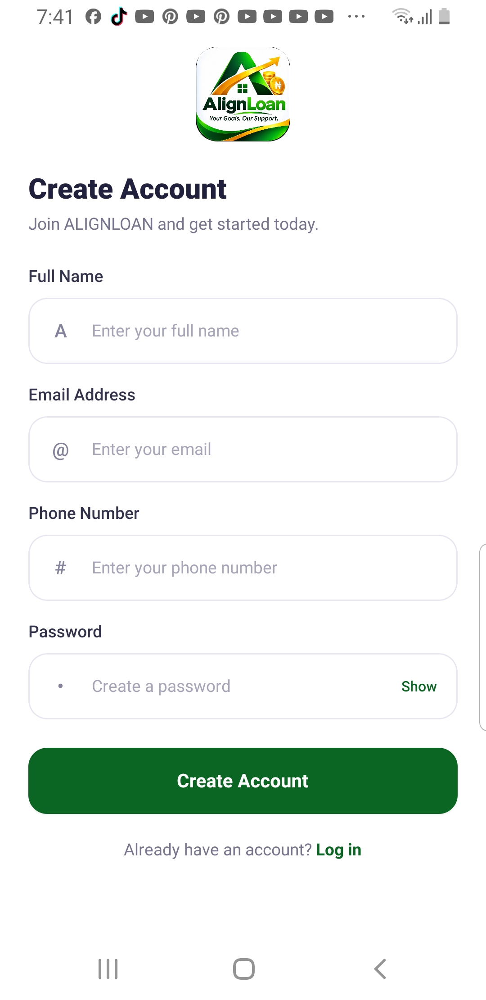
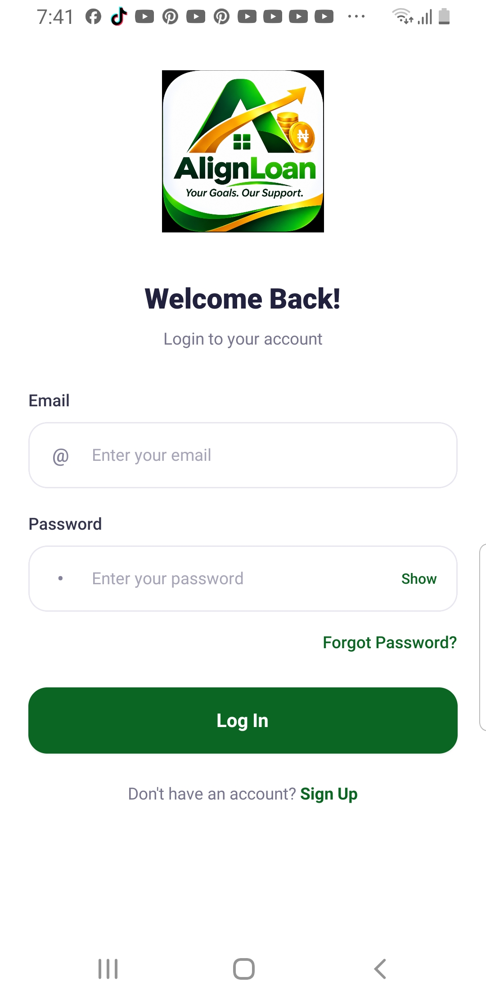
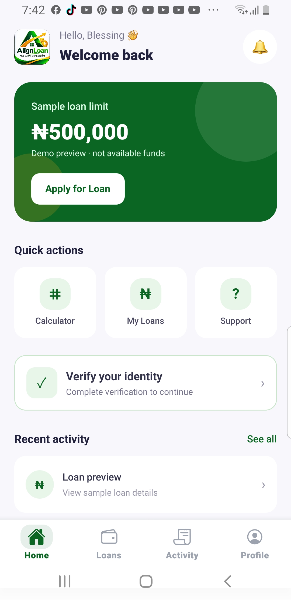
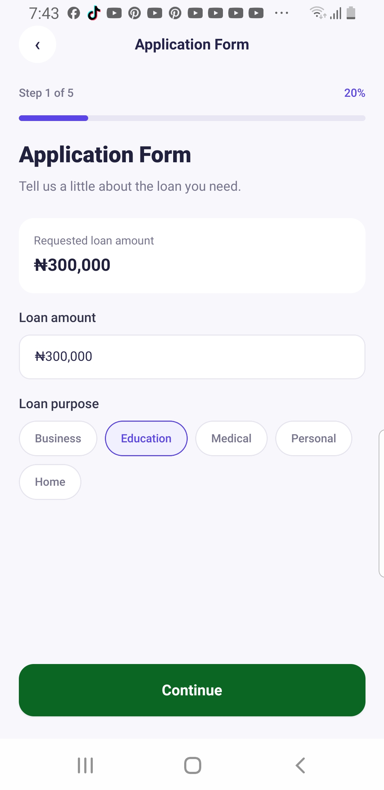
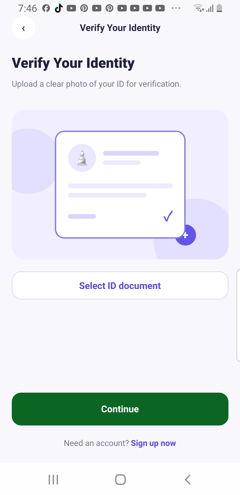
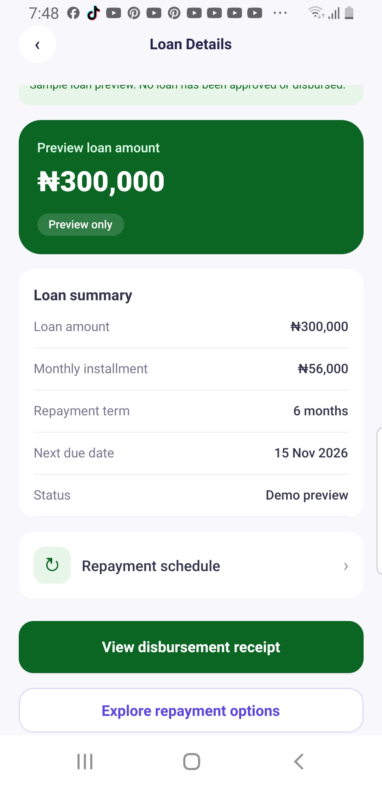
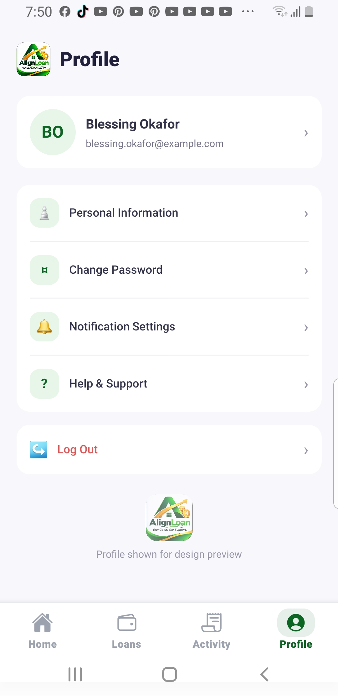

# ALIGNLOAN – Mobile Loan Application

ALIGNLOAN is a modern mobile loan application built with React Native and Expo. It is designed to provide users with a simple and user-friendly experience for exploring loan services and managing loan-related activities.

## ✨ Features

- User login interface
- Account registration interface
- User-friendly mobile screens
- Loan application interface
- Loan information and management screens
- Clean and modern user interface
- Easy navigation between screens

## 🛠️ Technologies Used

- React Native
- Expo
- Expo Router
- JavaScript
- TypeScript
- NativeWind / Tailwind CSS
- Git and GitHub

## 🎯 Project Purpose

ALIGNLOAN was developed as a mobile development portfolio project to demonstrate practical skills in building modern mobile application interfaces, organizing application screens, and creating user-friendly experiences using React Native and Expo.

## 👨‍💻 Developer

**Obechna Mobile**

React Native Mobile App Developer

## 📱 ALIGNLOAN App Screenshots

